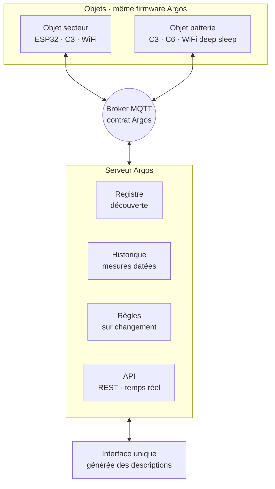

# Argos

Plateforme IoT générique : **un firmware unique pour tous les objets ESP32**, configurés depuis une interface web, qui communiquent par MQTT avec un serveur local.

> Statut : conception. Le code arrive étape par étape, voir la [feuille de route](#feuille-de-route).

## Principes

- **Chaque objet est générique** : tous exécutent le même firmware, seule leur configuration change.
- **Chaque objet est indépendant** : il se connecte lui-même au broker, sans passer par une autre carte.
- **On écrit du code pour un nouveau type de pilote, jamais pour un nouvel objet.**
- **L'objet décrit ce qu'il sait faire** : le serveur et l'interface s'adaptent à cette description.
- **Tout se règle depuis l'interface**, rien n'est écrit en dur.

## Architecture

Le détail (contrat MQTT, formats de description et de configuration, cycle de vie secteur et batterie, diagnostics, mise à jour à distance) est dans la [spécification](docs/specification.md).

## Organisation

| Dossier | Contenu |
|---|---|
| [`docs/`](docs/) | Spécification et décisions d'architecture |
| [`firmware/`](firmware/) | Firmware unique (PlatformIO, un binaire par puce : ESP32, ESP32-C3, ESP32-C6) |
| [`serveur/`](serveur/) | Registre des objets, historique, moteur de règles, API |
| [`interface/`](interface/) | Interface web générée à partir des descriptions d'objets |

## Feuille de route

| Étape | Contenu | État |
|---|---|---|
| 0 | Spécification et structure du dépôt | Fait |
| 1 | Noyau firmware (mode secteur) + pilote `relais` | Fait |
| 2 | Registre + interface générique minimale | À faire |
| 3 | Pilote `vedirect` (BMV, MPPT) | À faire |
| 4 | Mode batterie + pilote `temperature` | À faire |
| 5 | Historique + règles | À faire |
| 6 | Mise à jour à distance (OTA) | À faire |
