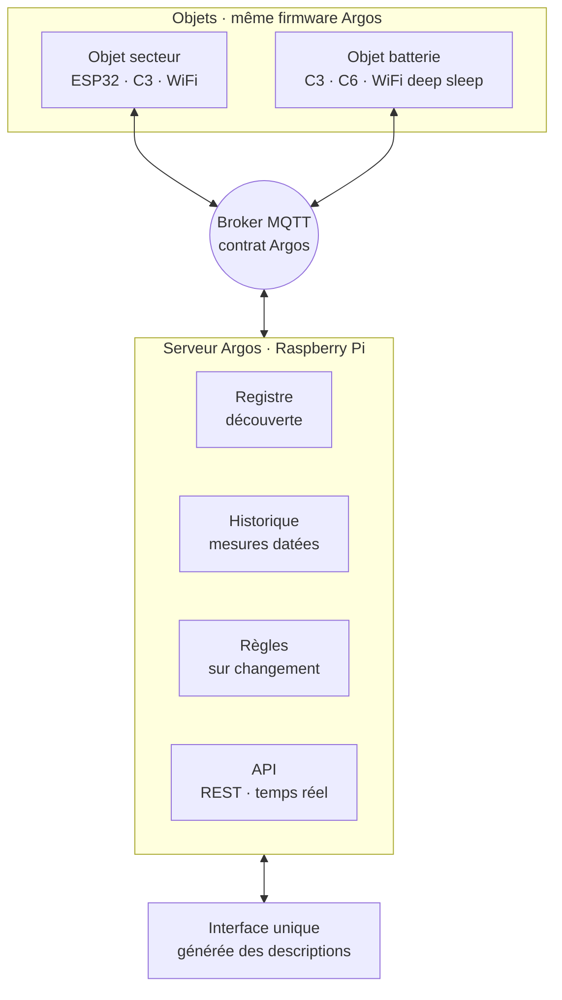

# Argos — Spécification de la plateforme

*Version 0.1 · brouillon · 28/10/2026*

Ce document décrit la future architecture d'Argos : un firmware unique pour tous les objets, un contrat MQTT commun, un serveur qui découvre les objets et une interface qui s'adapte à ce qu'ils annoncent. Il sert de référence pour la migration depuis l'architecture actuelle (le dépôt `Projet-Argos`).

---

## 1. Principes

1. **Chaque objet est générique.** Tous les objets exécutent le même firmware. Ce qui les différencie, c'est leur configuration, pas leur code.
2. **Chaque objet est indépendant.** Il se connecte lui-même au broker et ne dépend d'aucun autre objet pour fonctionner.
3. **On écrit du code pour un nouveau type de pilote, jamais pour un nouvel objet.** Ajouter un objet revient à le flasher, le connecter au WiFi et le configurer depuis l'interface.
4. **L'objet décrit ce qu'il sait faire.** Le serveur et l'interface s'adaptent à cette description, sans connaître les objets à l'avance.
5. **Tout se règle depuis l'interface.** La configuration est envoyée par MQTT et enregistrée sur l'objet.
6. **Rien ne bloque.** Aucune attente active, aucune boucle de reconnexion bloquante.
7. **Tout rend compte.** Chaque objet publie son statut et des compteurs de diagnostic, pour localiser une panne sans câble USB.

---

## 2. Architecture



Structure du firmware, de haut en bas :

| Couche | Contenu | Fixé par |
|---|---|---|
| Pilotes | VE.Direct, relais, température, entrées… | La configuration |
| Noyau commun | Configuration, description, diagnostics, mise à jour | Toujours présent |
| Cycle de vie et transport | Secteur ou batterie ; WiFi + MQTT | La configuration |
| Profil de carte | ESP32, ESP32-C3, ESP32-C6 | La compilation (un binaire par puce) |

---

## 3. Décisions prises

| Décision | Raison |
|---|---|
| Suppression de l'étage collecteur → orchestrateur | Les pertes de trames se règlent par une boucle non bloquante, l'isolation des pannes par les diagnostics. Un objet derrière une passerelle ne peut ni recevoir sa configuration ni être mis à jour à distance. |
| Objets sur batterie en WiFi direct | Respecte le principe d'indépendance. L'autonomie sera mesurée sur un premier thermomètre. |
| Zigbee écarté | Ajoute un écosystème parallèle (coordinateur, Zigbee2MQTT, second socle, second modèle de configuration). Seul le C6 le supporte. Pourra être réintégré plus tard comme source d'objets traduite, si besoin d'appareils du commerce. |
| ESP-NOW écarté pour l'instant | Rendrait les capteurs dépendants d'un objet relais, contraire au principe d'indépendance. Reste une option si l'autonomie en WiFi s'avère insuffisante. |
| Cartes supportées : ESP32, ESP32-C3, ESP32-C6 | Matériel existant. ESP8266 non supporté (un seul port série, peu de mémoire). |

---

## 4. Identité d'un objet

- **Identifiant (`id`)** : `argos-` suivi des 6 derniers caractères hexadécimaux de l'adresse MAC, par exemple `argos-3fa21c`. Il est stable et ne change jamais.
- **Nom** : libre, réglé depuis l'interface (« Lecteur Victron », « Thermomètre garage »). Il n'apparaît jamais dans les topics, pour qu'un renommage ne casse rien.

---

## 5. Contrat MQTT

Tous les topics d'un objet commencent par `argos/<id>/`.

| Topic | Sens | Retenu | Contenu |
|---|---|---|---|
| `status` | objet → | Oui | État de connexion (voir ci-dessous). Last Will : `{"etat":"offline"}` |
| `meta` | objet → | Oui | Description de l'objet (§ 6) |
| `config` | → objet | Oui | Configuration souhaitée (§ 7) |
| `config/appliquee` | objet → | Oui | Accusé de réception de la configuration |
| `state/<cle>` | objet → | Oui | Valeur actuelle d'une capacité |
| `set/<cle>` | → objet | Selon le type | Ordre sur une capacité (§ 5.2) |
| `diag` | objet → | Oui | Compteurs de diagnostic (§ 10) |
| `cmd` | → objet | Non | Commande ponctuelle : `redemarrer`, `identifier` |
| `ota` | → objet | Oui | Demande de mise à jour (§ 11) |

### 5.1 Statut

```json
{ "etat": "online" }
{ "etat": "endormi", "prochain_reveil": "2026-10-28T14:20:00Z" }
{ "etat": "offline" }
```

- **Secteur** : `online` à la connexion ; `offline` publié automatiquement par le broker (Last Will) si l'objet disparaît.
- **Batterie** : `online` au réveil, `endormi` juste avant le deep sleep. Le serveur marque l'objet **en retard** s'il ne s'est pas réveillé à `prochain_reveil` + max(60 s, 20 % de l'intervalle).

### 5.2 Ordres

Deux types de capacités commandables, avec deux comportements :

- **`switch`** (relais, sortie) : l'ordre est un **état souhaité**, publié en message retenu. Un objet qui redémarre ou se réveille retrouve l'état qu'il doit avoir. L'objet confirme en publiant `state/<cle>`.
- **`action`** (impulsion de portail, redémarrage d'un appareil) : l'ordre est **ponctuel** et non retenu, pour qu'il ne soit jamais rejoué au redémarrage. Réservé aux objets sur secteur.

### 5.3 Format des valeurs

- Les valeurs sont des scalaires JSON : nombre (`12.85`), booléen (`true`), texte (`"Bulk"`).
- **Le pilote convertit dans l'unité déclarée** dans la description (V plutôt que mV, °C, %). Le serveur et l'interface n'ont aucune conversion à faire.
- Les `state` sont publiés **sur changement**, plus un rappel périodique (60 s par défaut, réglable) pour les objets sur secteur.

---

## 6. Description (`meta`)

Publiée par l'objet à chaque connexion et après chaque changement de configuration. Elle est calculée à partir des pilotes actifs.

```json
{
  "id": "argos-3fa21c",
  "nom": "Lecteur Victron",
  "firmware": { "version": "1.0.0", "puce": "esp32" },
  "alimentation": { "mode": "secteur" },
  "capacites": [
    { "cle": "bmv/V",   "nom": "Tension batterie", "type": "sensor", "unite": "V", "precision": 2 },
    { "cle": "bmv/SOC", "nom": "État de charge",   "type": "sensor", "unite": "%", "precision": 1 },
    { "cle": "mppt/PPV","nom": "Puissance solaire","type": "sensor", "unite": "W" },
    { "cle": "mppt/CS", "nom": "État de charge MPPT", "type": "text" }
  ]
}
```

Types de capacités :

| Type | Sens | Exemple | Widget par défaut |
|---|---|---|---|
| `sensor` | Lecture, valeur numérique | Tension, température | Carte + graphique |
| `binary` | Lecture, booléen | Porte ouverte | Indicateur |
| `text` | Lecture, texte | État du régulateur | Étiquette |
| `switch` | Lecture et écriture, booléen | Relais | Interrupteur |
| `action` | Écriture seule | Impulsion portail | Bouton |

Champs facultatifs : `unite`, `precision`, `min`, `max`, `categorie` (`mesure` par défaut, ou `diagnostic` pour les valeurs techniques à masquer par défaut).

La clé d'une capacité est `<instance de pilote>/<mesure>`, ce qui permet d'avoir plusieurs pilotes du même type sur un objet (BMV et MPPT, par exemple).

---

## 7. Configuration (`config`)

Publiée par le serveur en message retenu, enregistrée par l'objet dans sa mémoire non volatile (NVS).

```json
{
  "version": 7,
  "nom": "Lecteur Victron",
  "alimentation": { "mode": "secteur", "rappel_s": 60 },
  "pilotes": [
    { "type": "vedirect", "instance": "bmv",  "params": { "rx": 14, "tx": 27 } },
    { "type": "vedirect", "instance": "mppt", "params": { "rx": 26, "tx": 25 } }
  ]
}
```

Exemple sur batterie :

```json
{
  "version": 2,
  "nom": "Thermomètre garage",
  "alimentation": { "mode": "batterie", "intervalle_s": 600 },
  "pilotes": [
    { "type": "temperature", "instance": "temp", "params": { "capteur": "a_preciser", "broche": 4 } },
    { "type": "tension_batterie", "instance": "batt", "params": { "broche": 0, "diviseur": 2.0 } }
  ]
}
```

Règles :
- L'objet **valide** la configuration contre son profil de carte (broches existantes, nombre de ports série, pilotes disponibles).
- Il répond toujours sur `config/appliquee` :
  ```json
  { "version": 7, "ok": true }
  { "version": 8, "ok": false, "erreurs": ["broche 34 : sortie impossible sur cette carte"] }
  ```
- En cas d'erreur, il **garde la configuration précédente**.
- La `version` est incrémentée par le serveur à chaque modification ; l'objet ignore une configuration dont la version n'est pas supérieure à celle qu'il a déjà.

Les identifiants WiFi et l'adresse du broker ne font **pas** partie de cette configuration (voir § 8).

---

## 8. Première installation

1. **Flasher** le binaire correspondant à la puce, par USB, idéalement depuis un navigateur (ESP Web Tools) pour ne pas avoir besoin d'un environnement de développement.
2. **Connecter au réseau** : au premier démarrage, l'objet ouvre un point d'accès `Argos-3fa21c` avec un portail de configuration où l'on saisit le WiFi, l'adresse du broker et les identifiants MQTT.
3. L'objet se connecte et publie une description vide. Il apparaît dans l'interface comme **nouvel objet non configuré**.
4. On choisit ses pilotes et leurs paramètres dans l'interface. La configuration est envoyée, l'objet publie sa nouvelle description, et ses capacités apparaissent.

---

## 9. Cycle de vie

### 9.1 Mode secteur

- Boucle principale **sans aucun appel bloquant** : chaque pilote a une fonction `loop()` qui rend la main immédiatement.
- Lecture série dans une tâche FreeRTOS dédiée si le pilote en a besoin (VE.Direct), avec une file vers la boucle principale.
- Reconnexion WiFi et MQTT avec délai croissant entre les tentatives (1 s, 2 s, 4 s… plafonné à 60 s), sans jamais interrompre la lecture des pilotes.
- Publication des `state` sur changement et en rappel périodique ; `diag` toutes les 60 s.

### 9.2 Mode batterie

À chaque réveil, dans cet ordre :

1. **Mesurer** avant d'allumer le WiFi (le capteur est lu radio éteinte).
2. **Se connecter** au WiFi en mode rapide : canal et point d'accès mémorisés en mémoire RTC, IP fixe si configurée.
3. **Publier** `status` (`online`), les `state` et `diag`.
4. **Lire** les messages retenus `config`, `set/...` et `ota` (fenêtre d'attente courte, ≈ 500 ms après l'abonnement).
5. **Appliquer** ce qui a changé, puis publier `config/appliquee`.
6. **Publier** `status` (`endormi`, avec `prochain_reveil`) et se rendormir.

Garde-fous :
- **Délai maximal par réveil** (10 s par défaut) : passé ce délai, l'objet se rendort quoi qu'il arrive, pour ne jamais vider la batterie sur un WiFi absent.
- En cas d'échec de connexion, l'échec est compté en mémoire RTC et remonté au réveil suivant dans `diag`. La mesure du réveil raté est perdue (pas de mise en mémoire tampon en v1).
- Si `ota` est présent, l'objet reste éveillé pour la mise à jour (§ 11).

---

## 10. Diagnostics (`diag`)

Champs communs à tous les objets :

```json
{
  "uptime_s": 86400,
  "redemarrages": 3,
  "cause_dernier_redemarrage": "brownout",
  "wifi_rssi": -67,
  "reconnexions_wifi": 1,
  "reconnexions_mqtt": 2,
  "publications_ko": 0,
  "memoire_libre": 182340,
  "derniere_erreur": "vedirect/bmv : checksum invalide",
  "pilotes": {
    "bmv":  { "trames_ok": 1520, "checksum_ko": 3, "debordements": 0 },
    "mppt": { "trames_ok": 1518, "checksum_ko": 0, "debordements": 0 }
  }
}
```

Champs supplémentaires en mode batterie : `tension_batterie`, `duree_reveil_ms`, `cause_reveil`, `echecs_wifi`.

Chaque pilote expose ses propres compteurs dans `pilotes.<instance>`.

---

## 11. Mise à jour à distance (OTA)

Le serveur publie sur `argos/<id>/ota` :

```json
{ "version": "1.1.0", "url": "http://serveur/firmware/argos-esp32-1.1.0.bin", "sha256": "…" }
```

- L'objet télécharge le binaire, vérifie son empreinte, l'installe et redémarre. Il publie le résultat dans `diag` et sa nouvelle version dans `meta`.
- En mode batterie, le message retenu sert de drapeau : l'objet le découvre au réveil et reste éveillé le temps de la mise à jour.
- Le serveur efface le message `ota` une fois la nouvelle version annoncée dans `meta`.
- Les ESP32 gardent deux partitions : si le nouveau firmware ne démarre pas correctement, l'objet revient à l'ancien.

---

## 12. Firmware

### 12.1 Interface d'un pilote

Chaque pilote implémente la même interface C++ :

| Méthode | Rôle |
|---|---|
| `demarrer(params)` | Valide ses paramètres et initialise le matériel |
| `boucle()` | Travail non bloquant, appelé en continu (secteur) |
| `mesurer()` | Prend une mesure ponctuelle (batterie) |
| `capacites()` | Liste ses capacités, pour la description |
| `ecrire(cle, valeur)` | Applique un ordre (`switch`, `action`) |
| `diagnostics()` | Ses compteurs propres |

Les pilotes s'enregistrent par leur nom de type (`"vedirect"`, `"relais"`…) ; le noyau les instancie à partir de la configuration.

### 12.2 Pilotes de la première version

| Type | Capacités | Remplace |
|---|---|---|
| `vedirect` | Toutes les clés reçues, avec noms et unités Victron | Collecteurs + Orchestrateurs |
| `relais` | Un `switch` par broche ; logique inversée réglable | Actionneurs |
| `temperature` | Une `sensor` en °C | Nouveau (capteur à préciser) |
| `tension_batterie` | Une `sensor` en V | Nouveau |
| `entree` | Un `binary` par broche | Nouveau |

### 12.3 Compilation

- Un seul dépôt, un projet PlatformIO avec un environnement par puce : `esp32`, `esp32c3`, `esp32c6`.
- Chaque binaire embarque un **profil de carte** : broches utilisables en entrée et en sortie, ports série disponibles, entrées analogiques, broches de réveil. Le profil est publié dans `meta` pour que l'interface ne propose que des choix valides.
- Les secrets ne sont jamais compilés dans le firmware : ils sont saisis à l'installation (§ 8).

---

## 13. Serveur

- **Registre** : s'abonne à `argos/+/meta` et `argos/+/status`, enregistre automatiquement chaque objet et ses capacités.
- **Historique** : enregistre chaque `state` avec son horodatage. SQLite suffit pour démarrer ; une base orientée séries temporelles (TimescaleDB, InfluxDB) si le volume grandit.
- **Règles** :
  - déclenchées **sur changement** d'état de la condition, pas à chaque message ;
  - conditions **déclaratives** (capacité, opérateur, valeur, combinées par ET / OU), jamais de code exécuté ;
  - hystérésis et délai minimal entre deux déclenchements ;
  - action = publier un `set` sur une capacité ;
  - rechargées à chaud quand elles sont modifiées.
- **API** : REST pour les données et la configuration, plus un canal temps réel (WebSocket) pour pousser les changements à l'interface au lieu de l'interroger toutes les 5 s.

---

## 14. Interface

- **Liste des objets** avec leur statut (en ligne, endormi, en retard, hors ligne).
- **Page objet générique**, identique pour tous :
  - mesures et commandes, affichées selon le type de chaque capacité ;
  - formulaire de configuration généré à partir du profil de carte et des pilotes disponibles ;
  - diagnostics.
- **Personnalisation** (nom, icône, seuils de couleur, capacités masquées) enregistrée sur le serveur, plus dans le code.
- **Historique** : graphiques à partir des vraies données.
- **Règles** : création et modification depuis l'interface.

---

## 15. Sécurité

- **MQTT** : un identifiant et un mot de passe par objet, et des ACL qui limitent chaque objet à `argos/<son id>/#`.
- **API** : authentification obligatoire ; CORS limité à l'origine de l'interface.
- **Règles** : jamais d'exécution de code.
- **OTA** : vérification de l'empreinte SHA-256 avant installation.

---

## 16. Migration depuis l'existant

Les nouveaux topics (`argos/argos-xxxxxx/...`) ne se mélangent pas avec les anciens (`argos/bmv/...`, `argos/relais/...`). Ancien et nouveau système peuvent donc tourner côte à côte pendant la transition.

| Étape | Contenu | Validation |
|---|---|---|
| 1 | Noyau firmware (secteur) + pilote `relais` | La carte de relais se pilote via le nouveau contrat |
| 2 | Registre + interface générique minimale | L'objet apparaît seul et se configure depuis l'interface |
| 3 | Pilote `vedirect` | Un seul ESP32 remplace collecteurs et orchestrateur |
| 4 | Mode batterie + pilote `temperature` | Premier thermomètre, mesure de l'autonomie réelle |
| 5 | Historique + règles | Graphiques réels, automatisations reprises |
| 6 | OTA | Mise à jour d'un objet sans câble |

---

## 17. Questions ouvertes

- Quel **capteur de température** pour les thermomètres (DS18B20, SHT3x, BME280…) ?
- Quelle **batterie** (Li-ion 18650, piles AA, LiFePO4) et quelles **cartes** pour les objets sur batterie (module nu ou carte de développement) ?
- Conserver **Next.js** pour l'interface ?
- Accès à l'interface **depuis l'extérieur** du réseau local, ou non ?
- Combien d'objets à terme ?
